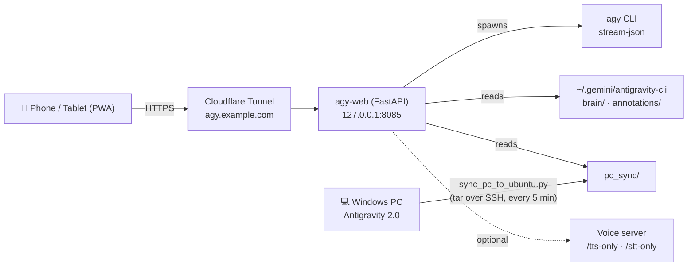

# Antigravity Web 🪐

**A self-hosted, mobile-first web app (PWA) for your [Google Antigravity](https://antigravity.google) agent conversations.**
Read every past conversation from your phone or tablet, continue them, start new ones, and see artifacts, diffs and subagents — like the Gemini app, but for your own Antigravity agent.

> [!NOTE]
> Unofficial community project. Not affiliated with or endorsed by Google. It reads Antigravity's local data files and drives the official `agy` CLI; those formats may change between Antigravity releases.

🇹🇷 [Türkçe açıklama aşağıda](#-türkçe)

---

## Why?

Antigravity runs on your desktop (Antigravity 2.0 / IDE) and the `agy` CLI runs on your Linux server — but there is no way to reach those conversations from a phone. Antigravity Web fills that gap:

- 💻 **Desktop conversations** are synced (incrementally, over SSH) to your server.
- 🐧 **Server conversations** are read directly from the `agy` CLI data dir.
- 📱 Both are merged into one searchable, installable web app behind your own subdomain.

## Features

| Area | What you get |
| :--- | :--- |
| **Conversations** | Unified PC + server history, full-text search (titles *and* transcripts), source filters, relative timestamps |
| **Chat** | Live token streaming via `agy --output-format stream-json`, model & reasoning-effort picker, workspace (project) picker, ⏹️ instant abort |
| **Continue anywhere** | Native resume for server conversations (`agy --conversation`), context bridge for desktop conversations (new turns are appended back to the transcript) |
| **Composer** | 📎 image/file upload (button + paste), `/` slash-command menu (`/plan`, `/boost`, `/goal`…), `@` mentions for files & past conversations |
| **Interactive** | Clickable `ask_question` option cards, "Proceed" card for implementation plans |
| **⚔️ Battle Mode** | Send one prompt to two models in parallel and compare answers side by side |
| **Side panel** | 📄 Artifacts (+ review comments sent back to the agent) · 📝 Diffs (green/red per file edit) · 🤖 Subagents tree · 🖥️ Terminal history (+ optional mini terminal) · 🧩 HTML widgets (`<agent-embed>`) |
| **Rendering** | Markdown, Mermaid diagrams, KaTeX math, carousels, GitHub alerts, copy-code buttons |
| **System hub** | Skills / rules / MCP inspector, systemd service status, create scheduled (cron) automations, permission mode |
| **🎙️ Voice (optional)** | Speech-to-text and read-aloud via your own voice server (e.g. faster-whisper + a TTS model) |
| **PWA** | "Add to Home Screen" for a full-screen, app-like experience; light/dark theme |

## Architecture



## Setup

### 1. Server (Ubuntu/Debian, with `agy` installed and logged in)

```bash
git clone https://github.com/keremuysal/antigravity-web.git ~/agy-web
cd ~/agy-web
python3 -m venv venv && venv/bin/pip install -r requirements.txt
cp .env.example .env && nano .env        # set AGY_WEB_PIN (min. 6 chars)
venv/bin/uvicorn server:app --host 127.0.0.1 --port 8085   # quick test
```

Run it as a service: edit `agy-web.service` (replace `YOUR_USER`), then

```bash
sudo cp agy-web.service /etc/systemd/system/
sudo systemctl daemon-reload && sudo systemctl enable --now agy-web
```

### 2. Expose it with HTTPS (Cloudflare Tunnel)

Create a tunnel in the Cloudflare Zero Trust dashboard with a public hostname such as `agy.example.com` → `http://127.0.0.1:8085`, then on the server:

```bash
sudo cloudflared service install <TUNNEL_TOKEN>
```

No open ports needed. Optionally put **Cloudflare Access** in front for a second login factor (recommended).

### 3. Sync your desktop conversations (Windows)

```powershell
setx AGY_REMOTE_HOST "ubuntu@YOUR_SERVER_IP"     # SSH key auth must already work
python sync_pc_to_ubuntu.py --full              # first full sync
# keep it in sync every 5 minutes in the background:
schtasks /Create /TN "AgyWebSync" /TR "pythonw.exe C:\path\to\sync_pc_to_ubuntu.py" /SC MINUTE /MO 5
```

The sync reads Antigravity's SQLite summary DB in **read-only** mode and only uploads changed files.

### 4. On your phone

Open `https://agy.example.com`, log in with your PIN, then **Share → Add to Home Screen**.

## Security

> [!WARNING]
> This app controls an autonomous agent on your server. By default it runs `agy` with `--dangerously-skip-permissions` (switchable to sandbox mode in Settings). Anyone with your PIN can make the agent run commands. Treat the PIN like an SSH password.

- PIN is required (min. 6 chars); 5 failed attempts per IP → 15-minute lockout.
- Sessions are HMAC-signed tokens; the signing secret is random per install (`.agy_web_secret`) unless you set `AGY_WEB_SECRET`.
- Cookies are `HttpOnly`, `Secure`, `SameSite=Strict`; no CORS; API docs disabled.
- Agent-generated HTML artifacts are served with `Content-Security-Policy: sandbox` so they can't touch your session.
- The mini terminal is **off** unless `AGY_WEB_ENABLE_TERMINAL=true`.
- Bind to `127.0.0.1` and expose only via a TLS tunnel/reverse proxy. Adding Cloudflare Access is strongly recommended.
- Synced conversations may contain secrets you pasted into chats — `pc_sync/` is git-ignored; keep the server private.

## Configuration

All settings are environment variables (see [`.env.example`](.env.example)): `AGY_WEB_PIN`, `AGY_WEB_SECRET`, `AGY_WEB_SESSION_DAYS`, `AGY_BIN`, `ANTIGRAVITY_DATA_DIR`, `AGY_WEB_DATA_DIR`, `AGY_WEB_ENABLE_TERMINAL`, `AGY_WEB_SERVICES`, `VOICE_SERVER_URL`.

## Project layout

```
server.py               FastAPI backend (API, transcript parser, agy streaming, auth)
static/index.html       Single-file PWA frontend (no build step)
static/manifest.json    PWA manifest
sync_pc_to_ubuntu.py    Windows → server incremental sync (tar over SSH)
pc_senkron_baslat.bat   Run the sync in a loop (Windows)
agy-web.service         systemd unit template
extras/voice_endpoints.py  Optional voice-server routes
```

## Contributing

Issues and PRs are welcome — especially macOS/Linux desktop sync, more transcript step types, and UI translations.

## License

[MIT](LICENSE) © Kerem Uysal

---

## 🇹🇷 Türkçe

**Antigravity Web**, Google Antigravity ajan konuşmalarına telefondan ve tabletten erişmen için kendi sunucunda barındırdığın, mobil öncelikli bir web uygulamasıdır (PWA). Gemini uygulaması gibi — ama kendi Antigravity ajanın için.

- 💻 Bilgisayarındaki **Antigravity 2.0** konuşmaları SSH üzerinden sunucuna senkronize edilir.
- 🐧 Sunucundaki **`agy` CLI** konuşmaları doğrudan okunur.
- 📱 Hepsi tek bir aranabilir uygulamada birleşir: geçmişi oku, kaldığın yerden devam et, yeni sohbet aç.

**Öne çıkanlar:** canlı yanıt akışı, ⏹️ durdurma, 📎 görsel/dosya yükleme, `/` komut ve `@` etiket menüleri, tıklanabilir soru kartları, ⚔️ iki modeli yarıştırma, Artifacts / Diffs / Alt ajanlar / Terminal paneli, Mermaid & KaTeX, yetenek/otomasyon merkezi ve isteğe bağlı 🎙️ Türkçe sesli konuşma.

Kurulum adımları yukarıdaki **Setup** bölümündedir. Güvenlik uyarısını mutlaka oku: uygulama sunucundaki ajanı kontrol eder, PIN'ini SSH şifresi gibi koru.

> Resmi olmayan bir topluluk projesidir; Google ile bağlantılı değildir.
